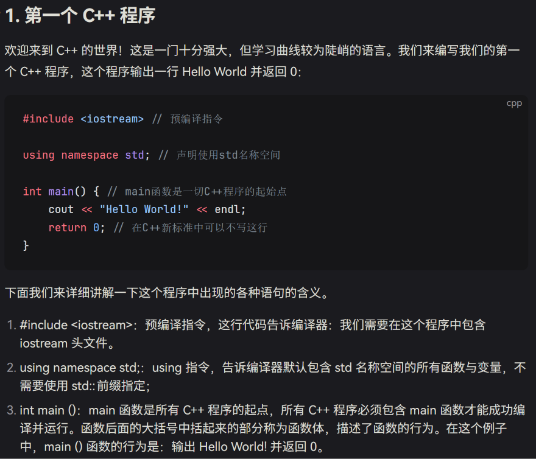

# 第 1 章 C++ 基础入门

欢迎来到我的 C++ 学习笔记。

这篇笔记记录我从零学习 C++ 时真正理解过的内容。

::: info 学习目标
这一章先认识 C++ 程序最基本的结构，并理解 `std::cout`、变量、输入与输出这些概念。
:::



## 1. 第一个 C++ 程序

先看一个最简单的程序：

```cpp {4}
#include <iostream>

int main() {
    std::cout << "Hello World!\n";
    return 0;
}
```

运行后会输出：

```text
Hello World!
```

::: tip 不要急着背
第一次看到 `#include`、`std::cout`、`return` 看不懂很正常。

现阶段更重要的是知道：程序会从 `main()` 开始执行。
:::

## 2. `std::cout` 是什么？

`std::cout` 是 C++ 标准库提供的标准字符输出流。

例如：

```cpp
int score = 100;

std::cout << score;
```

运行结果：

```text
100
```

可以暂时把它理解成：

> 把变量 `score` 当前保存的数据送到标准输出。

### 2.1 每一部分是什么意思？

| 写法 | 英文来源 | 目前可以怎么理解 |
| --- | --- | --- |
| `std` | standard | C++ 标准库使用的命名空间 |
| `::` | scope resolution operator | “某个作用域里面的” |
| `cout` | character output | 标准字符输出流 |
| `<<` | stream insertion operator | 把右边的数据送入输出流 |
| `score` | score | 一个变量 |
| `;` | semicolon | 一条语句结束 |

所以：

```cpp
std::cout << score;
```

可以暂时读成：

```text
std::cout ← score
```

也就是：

**输出 `score` 当前保存的值。**

::: warning 注意
`score` 和 `"score"` 完全不是一回事。

`score` 表示变量，而 `"score"` 表示文字。
:::

例如：

```cpp
int score = 100;

std::cout << score;
```

输出：

```text
100
```

但是：

```cpp
std::cout << "score";
```

输出：

```text
score
```

## 3. 变量

变量可以暂时理解成一个有名字的盒子。

例如：

```cpp
int age = 18;
```

可以想成：

```text
变量名：age

┌─────────┐
│   18    │
└─────────┘
```

其中：

`int` 来自 **integer**，意思是“整数”。

`age` 是变量名。

`18` 是变量最开始保存的值。

### 声明、初始化和赋值

```cpp
int age;
```

这是声明变量。

```cpp
int age = 18;
```

这是创建变量并初始化。

```cpp
age = 19;
```

这是重新赋值。

## 4. 输入与输出

输出使用：

```cpp
std::cout << age;
```

输入使用：

```cpp
std::cin >> age;
```

可以用箭头帮助记忆：

```text
输出：

cout ← age


输入：

cin → age
```

::: tip 我的记忆方法
`out` 表示向外，所以 `cout` 用于输出。

`in` 表示向内，所以 `cin` 用于输入。
:::

## 5. 本章小结

目前先记住：

- C++ 程序通常从 `main()` 开始执行。
- `std::cout` 用于标准输出。
- `std::cin` 用于标准输入。
- `int` 是整数类型。
- 变量可以保存数据。
- `=` 在变量语句中通常表示赋值。

下一章继续学习：[第 2 章 数据](./02-data.md)